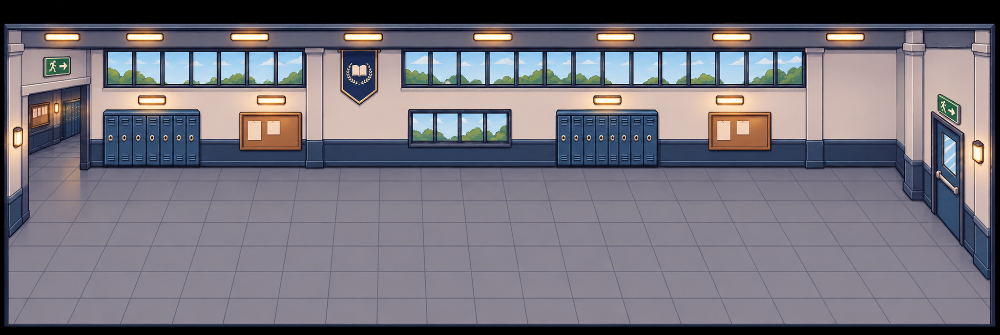
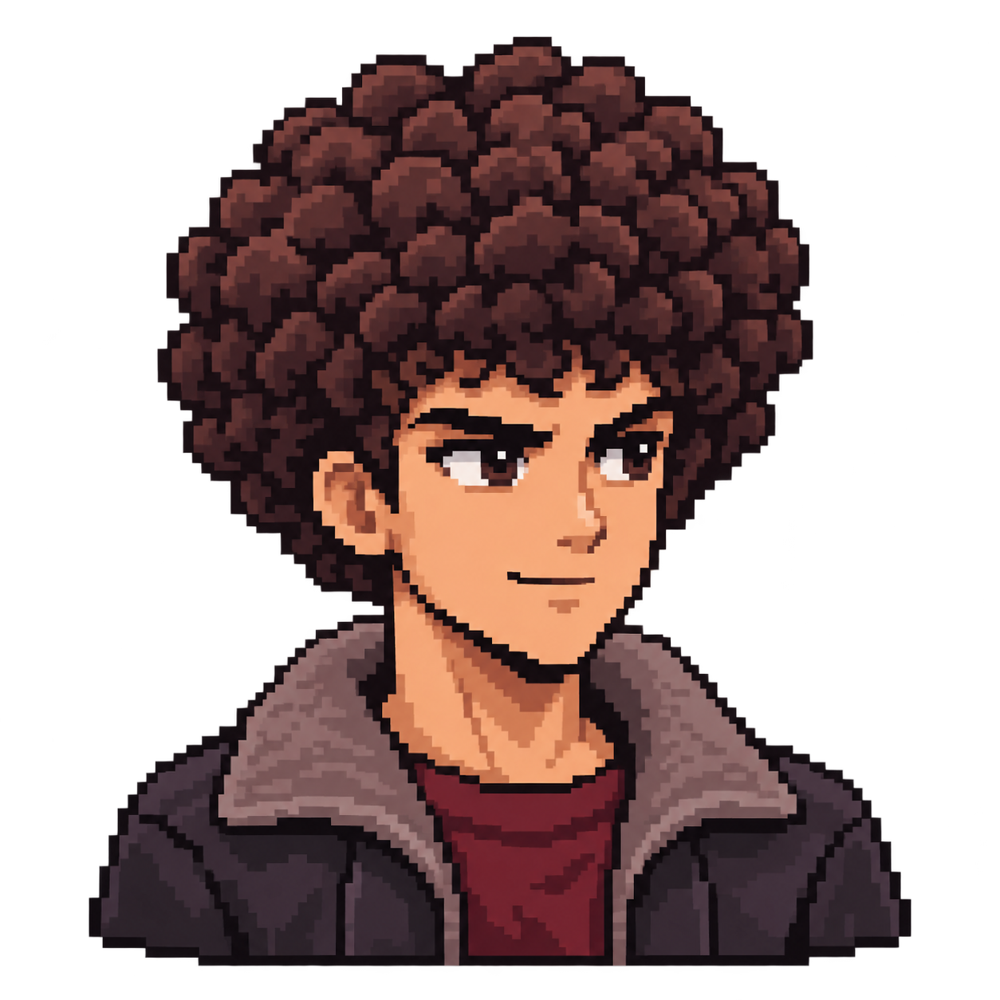
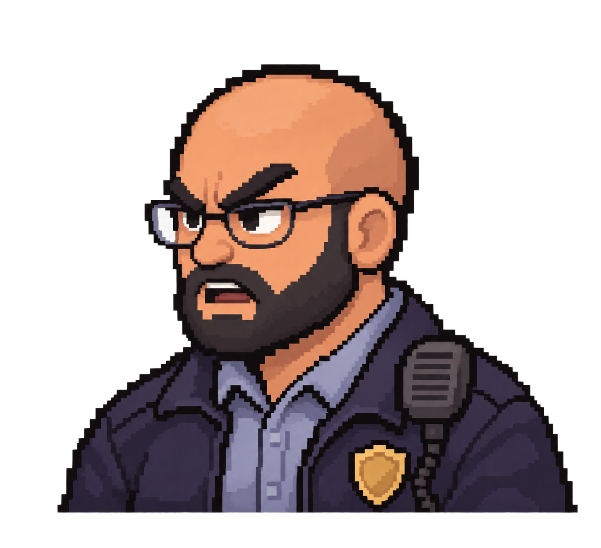

# School Escape

**Get out of school. Get past the Guard. Try again tomorrow.**

A browser-based, pixel-art RPG about a Player who keeps trying to escape school and a Guard who gets more prepared after every successful escape. Explore the hallway, meet the Music Guy, and face a turn-based battle at the gate.



## The escape loop

1. Explore the school hallway using WASD or the arrow keys.
2. Approach the gate to trigger a conversation with the Guard automatically.
3. Choose attacks, defenses, distractions and recovery moves in battle.
4. Win to escape and advance to the next day. Lose to retry the same day.

Successful escapes raise the Guard's readiness from **CASUAL → ALERT → PREPARED → DETERMINED → LOCKED IN**. Readiness caps on Day5; the day counter can keep going. Losing never lowers readiness or advances the day.

## Meet the characters

| The Player | The School Guard | The Music Guy |
| :---: | :---: | :---: |
|  |  |  |
| Backpack ready. School attendance optional. | The only thing between you and the gate. | Music by [@prodbyhajime](https://www.instagram.com/prodbyhajime/). |

The images above are the game's actual hallway and portrait assets, not screenshots of gameplay.

## Battle your way out

Combat uses **FAST → NORMAL → SLOW** priorities. Manage HP and SP, read statuses, and choose when to attack, defend or recover. The context panel explains each highlighted command and previews deterministic HP/SP changes.

| Player command | What it does |
| --- | --- |
| ATTACK | A reliable physical punch. |
| DEFEND | Reduces incoming damage, adds Player-only evasion and recovers SP for the round. |
| BRO, LOCK IN | Applies FOCUSED for better accuracy, critical chance and defense. |
| TALK SMACK | Deals fixed emotional damage and makes the Guard RILED. |
| LOOK THERE! | Distracts the Guard, with a chance to interrupt him and leave him OFF GUARD. |
| SWING BACKPACK | A heavy physical swing with lower accuracy and an SP cost. |
| CATCH BREATH | Pays30SP to restore up to150HP; offers no defense or SP recovery. |

The Guard has his own attacks, Defend, Crack Knuckles, Whistle, a once-per-battle Call Wife and a once-per-battle Donut. Statuses affect accuracy, damage, critical hits and protection. Full rules are in [Combat rules](docs/COMBAT_RULES.md).

## A learned Guard, not a stat boost

The live Guard uses a **frozen Q-learning table**. There is no learning during human battles. Day-based readiness changes how closely he follows his learned action ranking; it does not increase his HP, damage or accuracy.

The shipped `guard-q-v7` table is the selected **60k checkpoint** from one continuous100k experiment. It was chosen over the80k and100k checkpoints using held-out performance and behavior. Unvisited actions are not mistaken for learned zero values; completely unseen states use a safe Random fallback.

**F2** explains the Guard's visible situation and learned options in plain English. **A** inside F2 opens the technical Q/visit view. The current hidden Guard move stays hidden until reveal. **P** switches the diagnostic policy between Q-learning and Random.

[AI architecture](docs/GUARD_Q_LEARNING.md) · [Checkpoint results](docs/V7_COMBAT_GATE_PORTRAITS.md) · [Day/readiness design](docs/DAY_READINESS_PROGRESSION.md)

## Controls

| Where | Controls |
| --- | --- |
| Hallway | WASD / arrows to move; approach the gate for battle; Space near the Music Guy for audio settings. |
| Dialogue | Space / Enter / click reveals the current line; the next press advances. |
| Battle menu | W/S or up/down; Enter/Space to confirm;1–6 shortcuts; mouse hover/click. |
| Skills menu | A/left or Back/Escape to return; D/right opens Skills when selected. |
| Audio menu | Mouse click/drag sliders; up/down to select, left/right to adjust5%; Escape to close. |
| Debug | F2 for AI information; A inside F2 for Advanced; P to change diagnostic policy. |

## Music and sound

Talk to the Music Guy for separate **Hallway Music, Battle Music, Sound Effects and Footsteps** controls, plus music mute. Changes apply live and are saved when browser storage is available. Hallway music pauses for battle and keeps its playback position; battle music uses one looping instance.

Hallway and battle music: **[@prodbyhajime](https://www.instagram.com/prodbyhajime/)**, licensed under **[CC BY 4.0](https://creativecommons.org/licenses/by/4.0/)** with the artist's approval confirmed by the project owner. The recordings are unchanged. Attribution and redistribution details: [Music license](MUSIC_LICENSE.md).

The selected36-sound SFX palette covers menus, dialogue, battle entry, footsteps, attacks, statuses and results. Original source credits and CC0 terms are preserved in [SFX licenses](public/assets/audio/sfx/LICENSES.txt). [Sound selection report](docs/SFX_INTEGRATION_REPORT.md).

## Run locally

Use a modern browser and Node.js22 or newer.

```sh
npm ci
npm run dev
```

Open the local URL Vite prints. To build:

```sh
npm run build
```

Deploy the generated `dist/` folder to a static host. Vite is configured with a relative base path. Runtime graphics, music, SFX and the production AI table ship in `public/assets/`; raw animation sheets and old background iterations are not needed.

Run the deterministic tests with:

```sh
node --test
```

## Edit and develop

- **All authored dialogue:** [dialogueScript.js](src/game/dialogue/dialogueScript.js). [Editing guide](docs/DIALOGUE_EDITING.md).
- **Audio settings:** `src/game/audio/AudioSettings.js`; per-effect selections remain in the runtime SFX manifest.
- **Game scenes:** `src/game/scenes/SchoolScene.js`, `BattleScene.js`, `DayTransitionScene.js`.
- **AI/training:** `src/game/ai/` and `src/game/training/`; command-line tools remain under `tools/`.
- **Current UI/settings:** [Debug, portraits and audio](docs/DEBUG_DIALOGUE_AUDIO_SETTINGS.md), [Battle UI](docs/BATTLE_UI_POLISH.md).
- **Documentation index:** [docs/README.md](docs/README.md).

Old authoring exports, experiment checkpoints, frame-extraction caches and generated logs are excluded from the working repository. The processed runtime assets and production model remain. Historical inputs can be recovered from earlier Git commits if needed for regeneration; see [Repository cleanup](docs/maintenance/REPOSITORY_CLEANUP.md).

## License notices

- Game repository code: [Apache2.0](LICENSE).
- Phaser template notice: [MIT](LICENSE.phaser-template).
- The two music recordings: [CC BY4.0](MUSIC_LICENSE.md), credited to @prodbyhajime.
- Selected sound effects: [CC0/source notices](public/assets/audio/sfx/LICENSES.txt).
- These code/music notices do not grant a separate license for character or background artwork.
